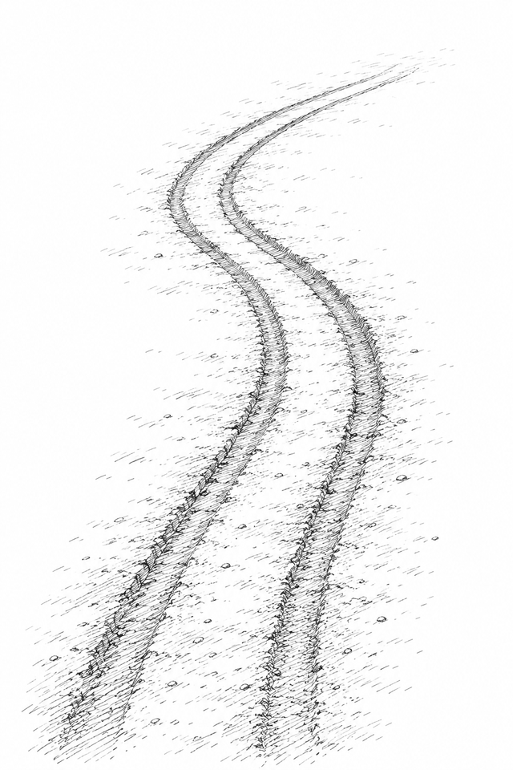

# wadachi

<p align="center"></p>

轍 *wadachi*: the ruts a wheel leaves in a road. The route that was actually
taken, not the one that was planned.

Wadachi is one record format for coding agent sessions from any harness:
Claude Code, Codex, OpenCode, Antigravity, Kiro and others. Convert their
session files into it once, and every tool and every agent reads them the same
way.

It keeps what happened and where each fact came from. It summarises nothing.
Summaries are cheap to make when someone asks a question; a lost detail cannot
be made at all.

Why this is not just observability, and what forged histories, poisoned
records, learning and dreaming have to do with it: [WHY.md](WHY.md).

## The rules

1. The harness's raw files are the truth. A wadachi record is a derived view,
   rebuilt from them at any time, byte for byte the same.
2. Never invent. A value that was not recorded is left out.
3. Every event points to the source and position it was read from.
4. A value inferred by a rule says so; everything else was read.
5. Interpretations, classifications and summaries live in separate annotation
   layers, each marked as computed, human or model-written.

## What it looks like

```
sessions/s_e6468e8dce041668.jsonl         header line, then one event per line
annotations/digest/s_e6468e8dce041668.jsonl
```

```json
{"actor":"tool","data":{"call_id":"tooluse_17","exit_code":1,"kind":"shell","status_as_recorded":"success","text":"test result: FAILED. 41 passed; 1 failed","tool":"execute_bash"},"id":"e_b9dd42b7a14e6f4a","of":"e_c39b7d9d395c0886","seq":2,"src":"f1:2412","turn":1,"type":"tool_result","x":{"kiro":{"credits":"0.42"}}}
```

A shell call that failed, which the harness recorded as a success. Both are
kept, side by side.

Each turn also gets a digest: one line, computed, never written by a model.

```
t1 h67 r1 e1 s1!1 q1 a1 ^1 2m9s @/home/tuomas/work/ksess/src/parse.rs
```

Turn 1: a human prompt of 67 characters, one read, one edit, one shell call
that failed, one search, one subagent, one correction from the human while the
agent worked, two minutes nine seconds, and the one path its edit named.

## In this repository

| Path | What |
|---|---|
| [`WHY.md`](WHY.md) | why the format exists, and what it is not |
| [`SPEC.md`](SPEC.md) | the format, version 0.1 (draft) |
| [`src/wadachi/schemas/`](src/wadachi/schemas/) | JSON Schemas for session lines and annotation lines |
| [`src/wadachi/`](src/wadachi/) | reference tools: validation, digests, ids, canonical JSON |
| [`examples/store/`](examples/store/) | three sessions: interactive, its subagent, and a headless run |
| [`conformance/`](conformance/) | files a validator must accept, and files it must reject with a named error |
| [`skills/wadachi/`](skills/wadachi/SKILL.md) | skill for agents that read, search, cite and annotate records |
| [`skills/wadachi-adapter/`](skills/wadachi-adapter/SKILL.md) | skill and converter template for supporting a new harness |
| [`adapters/`](adapters/) | what is known about each harness's records and hooks, and how sure it is |

## Use

```sh
pip install git+https://github.com/taituo/wadachi

wadachi validate examples/store
wadachi digest examples/store/sessions/s_e6468e8dce041668.jsonl

wadachi convert claude-code --list
wadachi dump --harness claude-code
wadachi convert codex --list
wadachi dump --harness codex
wadachi convert opencode --list
wadachi dump --harness opencode
wadachi dump --self --keep-raw
```

`dump` discovers sessions and skips unchanged source hashes. Its store defaults
to `$WADACHI_STORE` or `~/.wadachi/store`. `--from-herdr` selects the session ids
in Herdr's live snapshot. It prints counts, never session content. A store
inside a git working tree requires `--allow-inside-git`.

Python 3.10 or later; the only dependency is `jsonschema`. Everything the
skills describe also works with `jq` and `grep`.

## Status

Version 0.1, a draft. The format, schemas, tools and conformance suite are
consistent with each other and tested. Antigravity, Claude Code, Codex,
Grok and OpenCode converters are available. The notes in `adapters/` say for each harness what has been checked
against real files and what has not.
